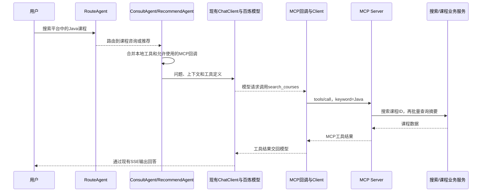

# MCP 课程查询接入

已实现 `search_courses`，由独立 MCP Server 调用现有搜索与课程服务，返回最多5条已上架课程摘要。
客户端将远程工具与现有本地工具合并后，按请求挂载到咨询和推荐 Agent 使用的 ChatClient。
第三方检索、课程详情/目录 MCP 工具和课程卡片适配仍未实现。

## 模块与包职责

- `tj-aigc`：引入 `spring-ai-starter-mcp-client-webflux`，继续使用现有 MVC 聊天入口。
  - `com.tianji.aigc.mcp.config.McpClientConfig`：连接 SDK 提供的远程 Provider 与工具注册器，支持关闭 MCP。
  - `com.tianji.aigc.mcp.config.McpToolProperties`：绑定每个 Agent 的远程工具名称列表。
  - `com.tianji.aigc.mcp.tool.McpToolRegistry`：按 Agent 筛选远程回调，工具不存在时明确报错。
  - `com.tianji.aigc.mcp.adapter`：后续适配课程卡片等展示数据。
- `tj-mcp-server`：引入 `spring-ai-starter-mcp-server-webmvc`，独立发布项目业务能力。
  - `com.tianji.mcp.server.config.McpServerConfig`：用 `MethodToolCallbackProvider` 显式发布课程工具。
  - `com.tianji.mcp.server.tool.CourseQueryTools`：`@Tool(name = "search_courses")` 入口。
  - `com.tianji.mcp.server.service.CourseQueryService`：通过 `SearchClient` 查询 ID，再通过 `CourseClient` 批量获取课程摘要。
  - `com.tianji.mcp.server.dto.request`：工具请求。
  - `com.tianji.mcp.server.dto.response.CourseSummaryDTO`：工具返回，价格 `priceFen` 的单位为分。

尚未使用的请求 DTO 和客户端 adapter 包通过 `package-info.java` 预留，不为这次简单查询额外包装。
两个模块不互相添加 Maven 依赖。服务端只扫描自身包，`tj-api` 的自动配置负责注册 Feign 接口。

## 版本与传输

沿用父工程 `spring-ai.version=1.0.0`，客户端与服务端分别导入同版本 BOM。
本次配置使用该版本支持的 HTTP/SSE 传输，客户端为 `SYNC`；WebFlux 传输与同步调用模式可以组合使用。

参考：

- [Spring AI 1.0 MCP Client](https://docs.spring.io/spring-ai/reference/1.0/api/mcp/mcp-client-boot-starter-docs.html)
- [Spring AI 1.0 MCP Server](https://docs.spring.io/spring-ai/reference/1.0/api/mcp/mcp-server-boot-starter-docs.html)

服务端默认地址为 `http://localhost:8095`，SSE 入口为 `/sse`，消息入口为 `/mcp/message`。
`/mcp/message` 是 SSE 会话的消息端点，并不是 Streamable HTTP 的 `/mcp` 端点。
第三方服务需要确认协议与鉴权后再添加命名连接；不将 Tavily 的 Streamable HTTP 地址直接填入 SSE 配置。

## 启动服务端

在项目根目录构建：

```powershell
mvn -pl tj-mcp-server -am -DskipTests package
java -jar tj-mcp-server/target/tj-mcp-server.jar
```

默认关闭 Nacos 注册发现，启动协议骨架不需要运行 Nacos、业务数据库或百炼模型。
接入业务查询时，设置以下环境变量，使注册中心、命名空间和分组与业务服务保持一致：

| 环境变量 | 默认值 | 说明 |
| --- | --- | --- |
| `MCP_SERVER_PORT` | `8095` | MCP 服务端口 |
| `MCP_DISCOVERY_ENABLED` | `false` | 是否启用 Nacos 注册发现 |
| `NACOS_SERVER_ADDR` | `127.0.0.1:8848` | 注册中心地址 |
| `NACOS_USERNAME` / `NACOS_PASSWORD` | 空 | 注册中心账号 |
| `NACOS_NAMESPACE` | 空 | 注册中心命名空间 |
| `NACOS_GROUP` | `DEFAULT_GROUP` | 注册中心分组 |

服务端启动不立即查询业务数据；执行 `search_courses` 时需要搜索服务、课程服务和对应基础设施可用。
关键词不能为空，去除两端空格后最多100个字符；课程按搜索顺序返回，排除未上架课程。
业务服务异常作为工具调用错误返回，不用空列表掩盖故障，也不提供虚构课程。
本工具只查询公开课程，不使用用户身份；后续个人学习工具需要单独接入鉴权。

## 启用 AIGC 客户端

默认 `spring.ai.mcp.client.enabled=false`，不因未启动 MCP Server 而影响现有 AIGC 启动。
先启动服务端，再在原有 AIGC 启动配置中叠加 `mcp` profile，例如：

```text
--spring.profiles.active=local,mcp
```

保留原有 AIGC 的 Nacos、Redis、模型等环境配置；此 profile 只增加 MCP 连接。
如 Nacos 中已配置相同的 `spring.ai.mcp.client` 属性，需检查最终生效的配置，避免覆盖本地联调值。

| 环境变量 | 默认值 | 说明 |
| --- | --- | --- |
| `MCP_CLIENT_ENABLED` | `true`（启用 mcp profile 后） | 是否初始化客户端连接 |
| `TJ_MCP_SERVER_URL` | `http://localhost:8095` | 服务根地址，不包含 `/sse` |
| `TJ_MCP_SSE_ENDPOINT` | `/sse` | SSE 路径 |

新增其他兼容 SSE 的服务时，在 `spring.ai.mcp.client.sse.connections` 下增加不同名称的连接。
密钥等凭据通过环境变量或配置中心注入。

`toolcallback.enabled=true` 使 Starter 提供 `SyncMcpToolCallbackProvider`。
`McpClientConfig` 将该 Provider 延迟接入 `McpToolRegistry`。
`AbstractAgent.getChatClientRequest()` 将本地 `@Tool` 转为回调，再与注册器选出的远程回调合并，
最后用 `.toolCallbacks(callbacks)` 挂到 `SpringAIConfig` 创建的同一个 ChatClient 的本次请求上。

在 `application-mcp.yml` 中，`tj.ai.mcp.agent-tools` 为 CONSULT 和 RECOMMEND 分配：

```text
tianji_aigc_mcp_client_tianji_course_search_courses
```

这是 Spring AI 1.0.0 将客户端名、连接名、服务端工具名组合并规范化后的名称。
服务端协议中的工具原名仍是 `search_courses`；SDK 回调负责还原名称并发送 `tools/call`。
如修改客户端名或连接名，要同步修改允许使用的回调名；名称不匹配时，注册器会列出已发现的名称。
ROUTE、BUY、KNOWLEDGE 未分配这个远程工具。MCP 关闭时各 Agent 继续使用原有本地工具。
挂载工具表示允许模型使用，不代表每条用户消息都会触发调用，模型仍根据提示词和用户问题决定。
该接入用于本地 Spring AI 的 ROUTE 链路，不会将工具自动传入百炼 APP 云端应用。

## 结构与调用顺序

```text
tj-mcp-server
  config/McpServerConfig
    → tool/CourseQueryTools.searchCourses
      → service/CourseQueryService.searchCourses
        → tj-api: SearchClient / CourseClient

tj-aigc
  application-mcp.yml → Starter → SyncMcpToolCallbackProvider
    → mcp/config/McpClientConfig → mcp/tool/McpToolRegistry
      → agent/AbstractAgent.getChatClientRequest
        → SpringAIConfig 提供的 ChatClient.prompt().toolCallbacks(...)
```

启动阶段：

1. 服务端创建 `CourseQueryTools`，`McpServerConfig` 将其发布为 MCP 工具。
2. 启用 `mcp` profile 后，客户端根据 SSE 地址创建连接并执行 `initialize`。
3. Starter 提供 `SyncMcpToolCallbackProvider` Bean，供注册器按需获取回调。
   当前 `McpToolRegistry.getToolCallbacks()` 在构造 Agent 请求时调用 Provider 的 `getToolCallbacks()`，
   由此触发 `tools/list`，发现工具并生成远程 `ToolCallback`，再按配置筛选。

一次聊天的调用阶段：



便于跟踪的断点：`McpServerConfig.courseQueryToolProvider()`、
`McpClientConfig.mcpToolRegistry()`、`McpToolRegistry.getToolCallbacks()`、
`AbstractAgent.getChatClientRequest()`、`CourseQueryTools.searchCourses()`、
`CourseQueryService.searchCourses()`。
客户端 DEBUG 日志记录每个 Agent 挂载的工具名；服务端 INFO 日志记录 `tools/call` 和结果数量。

启动服务端并启用业务服务发现、再启动 `local,mcp` 的 AIGC 后，在现有聊天页面发送：
“请搜索平台当前的 Java 课程，告诉我课程 ID、名称和价格。”
确认当前聊天模式为 `ROUTE`，并且 Nacos 中的路由提示词将选课类问题路由到 CONSULT 或 RECOMMEND。
价格返回单位为分，展示为元时需要除以100；当前结果交给模型生成文字，不生成新的课程卡片事件。

## 验证

编译打包：

```powershell
mvn -B -ntp -pl tj-aigc,tj-mcp-server -am -DskipTests package
```

现有回归测试（本机 JDK 25 下，Byte Buddy 需要以下测试 JVM 参数）：

```powershell
mvn -B -ntp -pl tj-aigc,tj-mcp-server -am '-DargLine=-Dnet.bytebuddy.experimental=true' test
```

专项测试：

```powershell
mvn -B -ntp -pl tj-aigc,tj-mcp-server -am '-Dtest=McpToolRegistryTest,McpAgentRequestTest,CourseQueryServiceTest,McpCourseToolIntegrationTest' '-Dsurefire.failIfNoSpecifiedTests=false' '-DargLine=-Dnet.bytebuddy.experimental=true' test
```

`McpCourseToolIntegrationTest` 启动真实 HTTP/SSE 服务端，验证工具发现、调用及参数错误；仅模拟下游业务接口。
`McpAgentRequestTest` 使用现有 `SpringAIConfig`、`ConsultAgent`、`RouteAgent`、ChatClient 和工具执行管理器，
验证本地/远程工具合并、流式请求调用回调及路由 Agent 不带业务工具；模型决策与远程业务返回使用测试替身，不调用百炼。

本次完整 `package` 验证通过75项测试。另使用实际 `application-mcp.yml`、客户端自动配置和独立服务端 JAR，
验证了回调名称绑定、CONSULT/ROUTE 工具分配，以及 WebFlux 回调经 MCP Server 和真实 Feign 适配器调用业务 HTTP 接口的顺序。
该网络验证的业务 HTTP 返回由本地测试服务提供，不依赖真实课程数据库，也未调用百炼。
